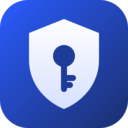
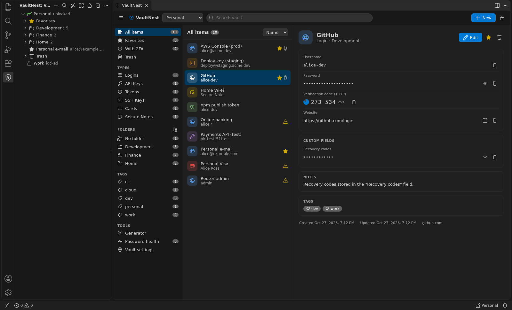
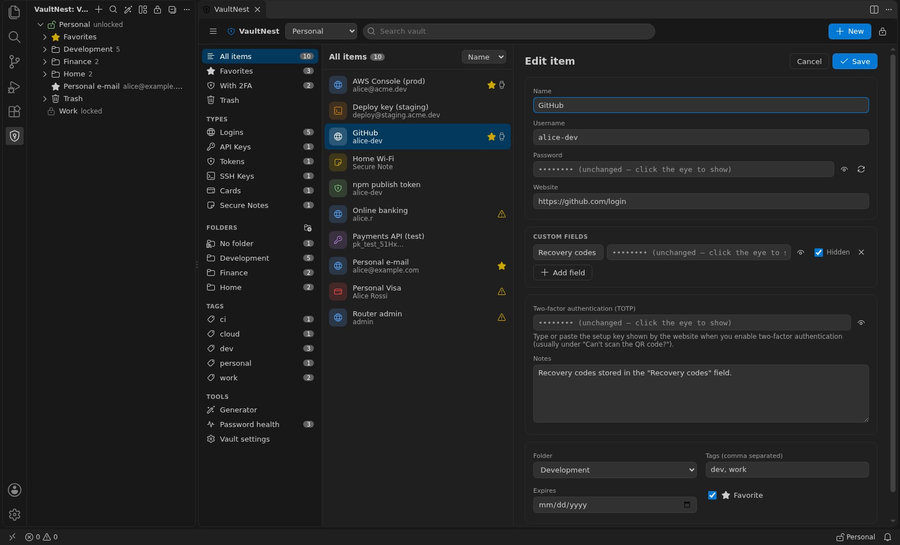
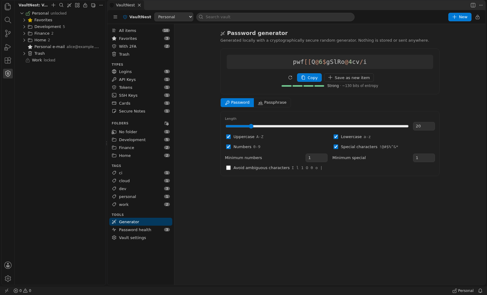
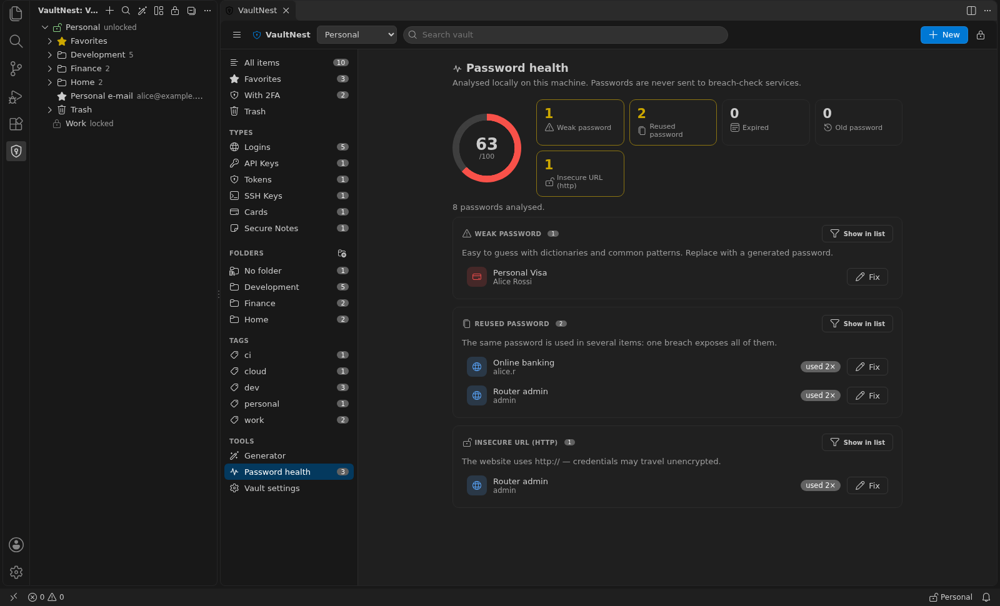
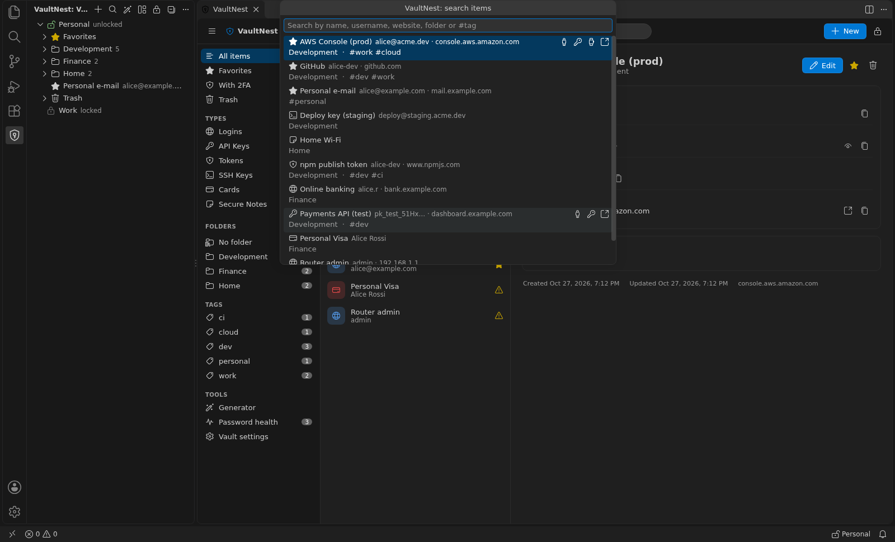
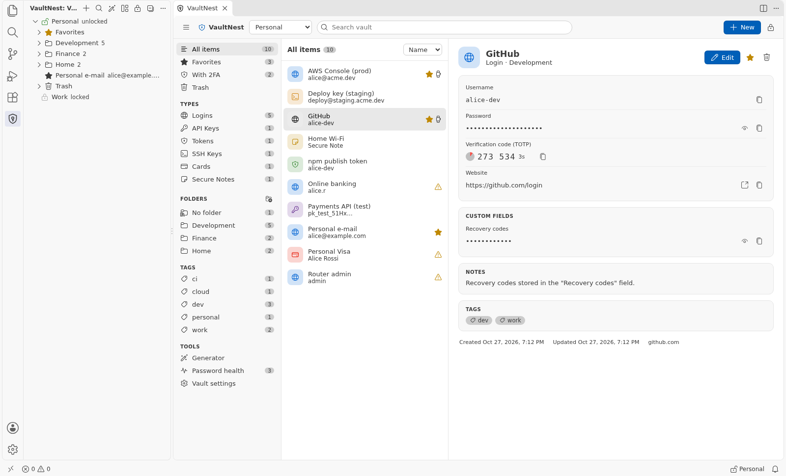

<p align="center">
  
</p>

<h1 align="center">VaultNest</h1>

<p align="center">
  <b>A secure, local-first vault inside Visual Studio Code.</b><br>
  Passwords, API keys, tokens, SSH keys and 2FA codes in an encrypted file in the open KDBX format that stays on your machine.
</p>

<p align="center">
  <a href="https://github.com/SeekNHack/PasswdVault/actions/workflows/ci.yml"></a>
  <a href="LICENSE"></a>
</p>



- **Your file, your machine.** Vaults are standard **KDBX 4** files (AES-256 + Argon2id). There is no cloud, no account and no telemetry, and the same file opens in any other app that supports KDBX 4.
- **Nothing else to install.** Every library is bundled in the extension. You don't need any other program.
- **Made for developers.** Keep API keys, tokens, SSH keys and `.env` values next to your code. Copy them in one keystroke, and they are cleared from the clipboard automatically.

---

## Contents

- [Features](#features)
- [Two-factor authentication (2FA)](#two-factor-authentication-2fa)
- [Getting started](#getting-started)
- [Everyday use](#everyday-use)
- [Using the vault on other devices](#using-the-vault-on-other-devices)
- [Settings](#settings)
- [Security](#security)
- [FAQ](#faq)
- [Development](#development)

## Features

| | |
|---|---|
| 🔐 **Encrypted vaults** | KDBX 4 with AES-256 and Argon2id, unlocked with a master password and, optionally, a key file. You can have several vaults; each one is either *global* or tied to a workspace. |
| 🔒 **Locked by default** | Vaults are locked when VS Code starts, after a configurable idle time, on demand (`Ctrl+Alt+L`) and optionally when the window loses focus. The master password is never stored. |
| 🗂️ **Every kind of secret** | Logins, API keys, tokens, SSH keys, cards and secure notes. Items can have custom fields (plain or hidden), folders, tags, favorites, expiry dates and 2FA codes. |
| 🛡️ **Two-factor codes (TOTP)** | Get 6- or 8-digit codes for any account: paste the setup key shown by the website into the item, and the current code is always one click away. |
| 🧭 **Dashboard** | Search, filters (type, folder, tag, favorites, *with 2FA*), item details and editor, password generator, health report and vault settings. It follows your light, dark or high-contrast theme. |
| ⚡ **Quick access** | `Ctrl+Alt+P` (`Cmd+Alt+P`) searches every unlocked vault. A sidebar tree and inline copy buttons are always one click away. |
| 🎲 **Generator** | Random passwords or EFF-wordlist passphrases from the OS cryptographic random generator, with a strength meter. |
| 🩺 **Password health** | Finds weak, reused, old and expired passwords and `http://` logins. The analysis runs entirely on your machine. |
| 📋 **Safe clipboard** | Copied secrets are cleared after 30 seconds, but only if the clipboard still holds them. |
| 💾 **No data loss** | Saves are atomic and verified. Rotating encrypted backups are kept, changes made by other apps are merged automatically, and an encrypted recovery copy is written if a save fails. |
| 🔁 **Import / export** | Import from other `.kdbx` files and from the JSON/CSV exports of popular password managers and web browsers. Export to an encrypted `.kdbx` or to CSV; CSV export asks for re-authentication. |

<table>
  <tr>
    <td width="50%"><br><sub><b>Editor.</b> Secrets stay hidden until you choose to reveal them.</sub></td>
    <td width="50%"><br><sub><b>Generator.</b> Passwords and passphrases with an entropy estimate.</sub></td>
  </tr>
  <tr>
    <td width="50%"><br><sub><b>Health report.</b> Weak, reused, expired and insecure items.</sub></td>
    <td width="50%"><br><sub><b>Quick search.</b> <code>Ctrl+Alt+P</code> from anywhere, with inline copy buttons.</sub></td>
  </tr>
</table>

## Two-factor authentication (2FA)

VaultNest can be your authenticator app. When a website asks you to enable 2FA, it shows a QR code and, usually under *Can't scan it?*, a text **setup key**:

1. Open the item in the dashboard and click **Edit** (or **Set up 2FA…** on items without a code).
2. Paste the setup key (or an `otpauth://` link) into *Two-factor authentication*, then save.
3. Copy the 6-digit code from the item, from quick search or with **VaultNest: Copy TOTP Code**.

Codes are stored as an `otpauth://` URI in the `otp` field, the format most KDBX apps use, so they show the same codes. `TimeOtp-*` fields are read too.

## Getting started

1. Click the **VaultNest** shield in the Activity Bar.
2. Choose **Create New Vault**, or **Open Existing .kdbx** to use a file you already have.
3. Choose a name, a location and a strong master password. **A forgotten master password cannot be recovered.**
4. Add items with the **+** button in the sidebar or in the dashboard (**VaultNest: Open Dashboard**).

## Everyday use

| Task | How |
|---|---|
| Search and copy | `Ctrl+Alt+P` / `Cmd+Alt+P`, type, then use the inline buttons (username, password, 2FA code, open URL) or press Enter for more actions |
| Copy from the sidebar | Hover an item for the key/person icons, or right-click it |
| Copy a 2FA code | The copy button next to the live code, or **VaultNest: Copy TOTP Code** |
| Insert a secret into a file | **VaultNest: Insert Secret into Editor…** (for example into a local `.env`) |
| Generate a password | **VaultNest: Generate Password…** or the generator in the dashboard |
| Lock everything | `Ctrl+Alt+L` / `Cmd+Alt+L`, the lock icon, or the status bar item |

Dashboard shortcuts: `Ctrl+F` or `/` search · `Ctrl+N` new item · `E` edit · `Ctrl+S` save · `Esc` cancel · `Ctrl+G` generator · `Ctrl+L` lock.

<p align="center"><br><sub>The dashboard follows your VS Code theme.</sub></p>

## Using the vault on other devices

The vault is an ordinary KDBX file. Keep it in a folder you sync yourself (a sync service, a network drive, a USB stick) and open it with any app that supports KDBX 4. When the file changes on disk, VaultNest merges the changes on its next save. To merge right away, run **Reload / Merge Changes from Disk**.

Metadata specific to VaultNest (item type, favorite) is stored in KDBX 4 `CustomData`; other clients ignore it but keep it.

## Settings

All settings are *application-scoped*, so a workspace's `.vscode/settings.json` cannot weaken them.

| Setting | Default | Description |
|---|---|---|
| `vaultnest.autoLock.minutes` | `15` | Lock after this many minutes without activity in VS Code (`0` = never) |
| `vaultnest.autoLock.onWindowBlur` | `false` | Lock when the VS Code window loses focus |
| `vaultnest.autoLock.blurGraceSeconds` | `0` | Delay before the focus-loss lock |
| `vaultnest.clipboard.clearAfterSeconds` | `30` | Clear copied secrets after N seconds (`0` = never) |
| `vaultnest.backup.enabled` | `true` | Keep rotating encrypted backups |
| `vaultnest.backup.count` | `10` | Backups kept per vault |
| `vaultnest.backup.intervalMinutes` | `60` | Minimum minutes between automatic backups |
| `vaultnest.backup.location` | `extensionStorage` | `extensionStorage`, or `besideVault` (`.vaultnest-backups/` next to the file) |
| `vaultnest.security.kdfMemoryMiB` | `64` | Argon2id memory for new vaults and password changes |
| `vaultnest.security.kdfIterations` | `3` | Argon2id iterations for new vaults and password changes |
| `vaultnest.security.minMasterPasswordScore` | `2` | Minimum strength score (0–4, from length and character variety) for a new master password before a warning |
| `vaultnest.ui.showPasswordStrength` | `true` | Show the strength meter in the editor |
| `vaultnest.ui.openDashboardOnUnlock` | `false` | Open the dashboard after unlocking |
| `vaultnest.ui.showStatusBar` | `true` | Show the lock indicator in the status bar |
| `vaultnest.health.maxPasswordAgeDays` | `365` | Age after which a password is reported as old |

## Security

- **No custom cryptography.** The format and the encryption come from [kdbxweb](https://github.com/keeweb/kdbxweb); Argon2 comes from [hash-wasm](https://github.com/Daninet/hash-wasm); random numbers come from the operating system's CSPRNG.
- **Decrypted data stays in memory**, only in the VS Code extension host and only while a vault is unlocked. Protected fields stay XOR-masked until they are used.
- **The dashboard is sandboxed.** It runs under a strict Content Security Policy, every message it sends is schema-validated, and it never receives a secret unless you click *reveal* or *edit*. Copying happens in the extension host.
- **Nothing leaves your machine.** The extension makes no network requests, collects no telemetry and has no AI integration. Secrets are never logged.

Read [SECURITY.md](SECURITY.md) for the threat model, the known limitations (including that the project **has not been independently audited**) and how to report a vulnerability privately.

## FAQ

**Do I need another program installed?** No. VaultNest reads and writes KDBX files by itself.

**I forgot my master password. Can you recover it?** No. Nobody can: that is what makes the encryption meaningful. Keep a written copy somewhere safe.

**Can other extensions read my passwords?** VS Code runs all extensions in one process without isolation from each other. While a vault is unlocked, install only extensions you trust. See [SECURITY.md](SECURITY.md).

**Does it work in Remote / WSL / Codespaces?** VaultNest runs where the VS Code extension host runs. In remote setups that is the remote machine, so the vault file and the decrypted data are there.

## Development

```bash
npm install
npm run build            # bundle to dist/ (esbuild)
npm run typecheck        # TypeScript (host + webview)
npm test                 # unit tests (vitest)
npm run test:integration # runs the extension in a real VS Code (needs a display or xvfb-run)
npm run package          # creates vaultnest-<version>.vsix
```

Press `F5` in VS Code to start an Extension Development Host. [docs/ARCHITECTURE.md](docs/ARCHITECTURE.md) describes the design, and [docs/DEVELOPMENT.md](docs/DEVELOPMENT.md) describes testing and the release process.

## License

[MIT](LICENSE). Third-party components are listed in [NOTICE.md](NOTICE.md).
